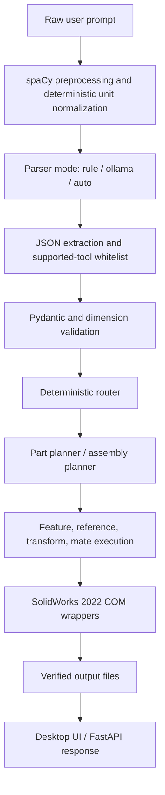

# SolidWorks Local CAD Automation

Local Prompt-to-CAD system for SolidWorks 2022. The project turns a natural-language request into a validated CAD intent, plans deterministic part or assembly operations, executes only supported SolidWorks COM wrappers, and verifies generated local outputs.

No cloud LLM APIs are used. Ollama, when enabled, is only an intent parser and never calls SolidWorks directly.

## Architecture



## Supported Operations

Primitive parts:

- `create_cube`
- `create_block`
- `create_cylinder`
- `create_shaft`
- `create_disc`
- `create_plate`
- `create_plate_with_hole`
- `create_tube`
- `create_cone`
- `create_sphere`
- `create_torus`

Feature-based part planning:

- `boss_extrude`
- `cut_extrude`
- `hole`
- `fillet`
- `chamfer`
- `shell`

Assembly templates:

- `base_plate_with_cylinders`
- `tube_with_two_end_discs`
- `simple_shaft_with_two_wheels`
- `flanged_shaft_assembly`

Assembly constraints:

- `fixed`
- `coincident`
- `concentric`
- `distance`
- `parallel`
- `angle`

The schema and planner are structured for later extension to revolve, sweep, loft, mirror, linear/circular patterns, and threads.

## Parser Modes

- `rule`: deterministic parser only.
- `ollama`: local Ollama JSON parser only, followed by strict Pydantic validation.
- `auto`: tries the deterministic parser first, then calls Ollama if the rule parser cannot confidently parse the prompt.

Ambiguous prompts do not execute. For example, `Create a shaft` returns clarification metadata instead of inventing dimensions. `Create a shaft 100 mm long and 30 mm in diameter` parses directly.

Before either parser runs, the NLP layer preserves the raw prompt and produces normalized engineering text. It uses spaCy tokenization where available plus deterministic helpers for number words, quantities, synonyms, and conversion of millimetres, centimetres, and metres into millimetres. If `en_core_web_sm` is unavailable, unit normalization continues with a lightweight fallback and reports a diagnostic.

Example:

```text
Make me a hollow pipe that's 8 cm long, 5 cm across outside and has a 3 cm bore
```

is normalized to a tube request with an 80 mm length, 50 mm outer diameter, and 30 mm inner diameter before parsing.

## Ollama Setup

Install Ollama locally, then pull the configured JSON-capable model:

```powershell
ollama pull llama3.2
```

Copy `.env.example` to `.env`, or configure equivalent environment variables:

```dotenv
OLLAMA_BASE_URL=http://127.0.0.1:11434
OLLAMA_EXECUTABLE=C:\Users\Eva\AppData\Local\Programs\Ollama\ollama.exe
OLLAMA_MODEL=llama3.2
OLLAMA_TIMEOUT_SECONDS=60
```

The executable path is configuration, not business logic. Communication still uses the local HTTP API at `http://127.0.0.1:11434`. When that API is unavailable, the client checks the configured executable, launches `ollama.exe serve` without a visible terminal window, and polls `/api/tags` until startup succeeds or times out. A shared lock and tracked process prevent duplicate launches.

The API exposes `GET /api/ollama/status` to report server and model availability. Startup failures return the structured code `ollama_unavailable`.

## SolidWorks Requirements

- Windows with SolidWorks 2022 installed.
- `pywin32` installed in the active Python environment.
- Template preferences may need to be configured in SolidWorks if default document creation fails.

The shared connection layer first attaches to a running SolidWorks instance and falls back to `Dispatch("SldWorks.Application")` to launch it automatically. Worker threads initialize and release COM explicitly. The SolidWorks layer uses explicit wrapper functions only; it does not execute model-generated Python, arbitrary COM method names, or arbitrary user-supplied paths.

## Setup

```powershell
python -m venv .venv
.\.venv\Scripts\Activate.ps1
pip install -r requirements.txt
python -m spacy download en_core_web_sm
```

If using the existing `venv`, confirm its Python executable still points to an installed interpreter.

## Run The CLI

```powershell
python app.py
```

The CLI supports dry-run and real SolidWorks modes.

## Run The Desktop UI

```powershell
python -m desktop_ui.app
```

The UI includes parser mode selection, Ollama status and auto-start, raw and normalized prompt logging, validated intent preview, execute/cancel controls, SolidWorks connection status and auto-launch, and assembly verification summaries.

## Run The API

```powershell
uvicorn api.main:app --reload
```

Useful endpoints:

- `GET /api/health`
- `GET /api/status`
- `GET /api/ollama/status`
- `POST /api/parse`
- `POST /api/execute`
- `GET /api/outputs`

Example dry-run request:

```json
{
  "prompt": "Create a tube with 50 mm outer diameter, 30 mm inner diameter and height 80 mm",
  "parser_mode": "auto",
  "mode": "dry_run",
  "confirmed": true
}
```

## Output Locations

Generated files are kept outside source control under the local user output root:

- `Documents\MCP SolidWorks\Outputs\Parts`
- `Documents\MCP SolidWorks\Outputs\Exports`
- `Documents\MCP SolidWorks\Outputs\Assemblies`

Output path handling uses `pathlib`, filename sanitization, safe output-root checks, and post-save existence verification.

## Testing

Standard tests mock SolidWorks COM and Ollama HTTP calls:

```powershell
python -m unittest discover -s tests
```

Current local verification: **158 tests passed** on November 12, 2026. The test suite is mock-based and does not claim that SolidWorks mates or feature calls work in a real installation.

If pytest is installed:

```powershell
python -m pytest tests
```

Manual integration tests are Windows-only and require SolidWorks and the configured Ollama model. Both applications may be closed before testing because the desktop workflow can start them when needed.

Suggested manual SolidWorks checks:

- cube
- cylinder
- plate
- plate with hole
- tube
- feature-based part with fillet or chamfer
- base plate with two cylinders
- tube with two end discs
- flanged shaft assembly

Suggested Ollama prompt checks:

- `Create a 50 mm cube`
- `Create a plate 100 mm long, 60 mm wide and 5 mm thick with a central 20 mm hole`
- `Create a tube with 50 mm outer diameter, 30 mm inner diameter and height 80 mm`
- `Create an assembly with a tube and one disc at each end`
- `Create a shaft 100 mm long and 30 mm in diameter`
- `Create a shaft` should request clarification.

Verified real local flow:

- Ollama started from a fully stopped state and loaded `llama3.2`.
- The hollow-pipe prompt above normalized and validated as `create_tube` with 80/50/30 mm dimensions.
- SolidWorks launched from a fully stopped state, created one solid body, and saved `tube_OD50_ID30_H80mm.SLDPRT` under the Parts output directory.

This verification used the real application service and COM document readback. A desktop click-through and visual geometry inspection should still be performed before a release demonstration.

## Troubleshooting

- SolidWorks COM failures: check the SolidWorks installation and document templates; the application will attempt to launch SolidWorks automatically.
- Through-all cuts: the wrapper attempts `FeatureCut4`, then `FeatureCut3`, then `FeatureCut2`, with diagnostics for selected object count, sketch state, base body existence, COM exceptions, and return values.
- Ollama unavailable: verify `OLLAMA_BASE_URL`, `OLLAMA_EXECUTABLE`, and local firewall access. The application normally starts `ollama.exe serve` automatically.
- Model missing: run `ollama pull <model>` and set `OLLAMA_MODEL`.
- Invalid prompt: use parser metadata to inspect missing fields or unsupported operations.
- Save failures: check write access to `Documents\MCP SolidWorks\Outputs`.

## Limitations

- Geometric face/edge reference resolution is isolated in the SolidWorks selection and geometry layers. Real face-frame, transform, and mate behavior must be visually verified for each assembly workflow; coordinate readback alone is not sufficient.
- Real SolidWorks verification cannot be replaced by mocked tests. In particular, do not treat unit-test success as proof that mates or feature operations succeed in SolidWorks.
- Ollama output is accepted only after JSON extraction and Pydantic validation. Invalid, unsupported, or ambiguous output is rejected before execution.
- The NLP and Ollama layers cannot execute CAD, Python, shell commands, arbitrary file paths, or arbitrary COM methods. Only validated intents reach the deterministic router.
